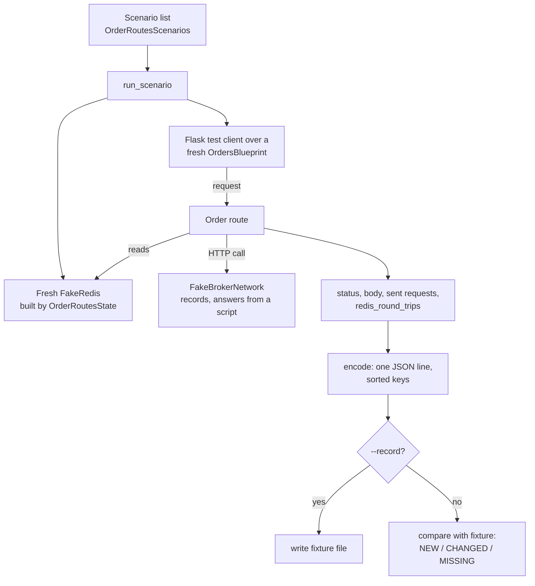

# Offline tests

UBI has no pytest suite. Instead, `test_runs/` holds twenty-seven plain Python scripts, each of which checks one part of the system against scripted inputs. They are called "offline" because they need no network, no broker, no Redis and no database: every outside service is replaced by a stand-in that lives in memory. You run each one as a module from the project root.

```bash
.venv/bin/python -m test_runs.order_routes
```

Because they are plain scripts, there is no way to run a single case other than editing or importing the module. Each one prints its result and exits 0 when everything passes and 1 when something differs.

## The suites

The table below lists all twenty-seven. "Fixture" is the recording a suite compares against, if it has one, and "Runtime" is what one run took on this machine on 2026-10-30.

| Command | What it pins | Fixture | `--record` | Runtime |
|---|---|---|---|---:|
| `python -m test_runs.candle_parse` | The seven historical candle parsers, against payloads recorded from the live APIs on 2026-09-12 | none (expected values in the file) | no | 0.3 s |
| `python -m test_runs.unified_ticks_sessions` | The session gate against the exchanges' 2026 calendars: holidays, half-closed commodity days, NCDEX's shorter evening, Muhurat trading | none | no | 0.1 s |
| `python -m test_runs.order_routes` | `place`, `modify` and `cancel`: status, body, every outgoing broker request and the number of Redis round trips | `test_runs/fixtures/order_routes.jsonl` (620 scenarios) | rewrites the whole file | 3.6 s |
| `python -m test_runs.order_engine_routes` | How `POST /api/orders/place` hands orders to a stubbed engine, including timeouts and an engine that is down: status, body, the intents written to the stream, Redis round trips | `test_runs/fixtures/order_engine_routes.jsonl` (18) | rewrites the whole file | 1.0 s |
| `python -m test_runs.order_place_lists` | The list form of `place`, through the real engine, and `GET /api/orders/intents/<intent_id>`: each entry's status and body, the broker requests (sorted) and the Redis round trips | `test_runs/fixtures/order_place_lists.jsonl` (11) | rewrites the whole file | 0.9 s |
| `python -m test_runs.order_engine_changes` | Changes to orders the engine placed: a cancel and a modify through the ordinary routes, a refused change of validity, cancelling a parent, listing parents, refusals, and flatten halting an open parent | `test_runs/fixtures/order_engine_changes.jsonl` (18) | rewrites the whole file | 4.5 s |
| `python -m test_runs.order_change_lists` | The list form of `modify` and `cancel`: each entry's status and body, the broker requests (sorted, since a list sends on several threads) and the Redis round trips | `test_runs/fixtures/order_change_lists.jsonl` (24) | rewrites the whole file | 0.9 s |
| `python -m test_runs.order_engine` | The order engine daemon against scripted intents and stubbed brokers: replies, broker requests, acknowledgements, counters | `test_runs/fixtures/order_engine.jsonl` (716) | rewrites the whole file | 38 s |
| `python -m test_runs.order_engine_throughput` | The order engine's broker lanes against ten stub brokers that take 200 ms each: every order accepted, no broker sent more than 10 messages in any one second, and ten workers per broker at least 80 orders a second in total | none | no | 8.9 s |
| `python -m test_runs.broker_selection` | The lowest-cost broker selector's rankings from the cost table, its pacing through the day, the rate budget and daily order count it shares, and how the table is loaded, against scripted table rows, scripted Redis counts and a stand-in database connection | none | no | 0.3 s |
| `python -m test_runs.margin_calculators` | Every broker's margin calculator request against the bodies the live brokers accepted on 2026-09-30, and the reading of their recorded answers | `test_runs/fixtures/margin_calculators.json` | no | 0.3 s |
| `python -m test_runs.funds_check` | The margin estimate against the brokers' own calculators of 2026-09-30, hedge benefit, and which brokers the lowest-cost selector passes over for funds, against a scripted funds document | none | no | 0.3 s |
| `python -m test_runs.pre_trade_estimate` | The book walk, daily volatility and volume, the impact coefficients, the pre-trade estimate and the estimate check, against a stand-in database | none | no | < 0.1 s |
| `python -m test_runs.trade_charges` | The charge rate table, one day's charges against Flattrade's bill of 2026-10-19, and the real breakeven of bought and sold positions, with no database | none | no | 0.3 s |
| `python -m test_runs.daily_orders` | Choosing a day's orders from the combined orders document, the row each becomes, the write and the summary, against a stand-in Redis and database | none | no | < 0.1 s |
| `python -m test_runs.breakeven_levels` | The price flicker from scripted ticks, the switch-on, and the levels service's answer, fallbacks, errors and daily table reads, against in-memory tables | none | no | 0.3 s |
| `python -m test_runs.stop_slippage` | Following fired stops to their closes, the slip allowance's percentile and thirty-stop minimum, and the tripwire for bought and sold positions, against a stand-in database | none | no | 0.3 s |
| `python -m test_runs.execution_costs` | How a fill's cost is split into delay, latency, half spread and impact, which legs count, the write, and the latency calibration's figures, against a stand-in database | none | no | < 0.1 s |
| `python -m test_runs.order_flatten` | The panic button, including that every cancel is sent and confirmed before any close, and that `flat` waits for the positions to show zero | `test_runs/fixtures/order_flatten.jsonl` (12) | rewrites the whole file | 3.4 s |
| `python -m test_runs.instrument_routes` | `/details`, `/additional_details`, `/ltp`, `/ohlc`, `/quote`, `/prices` and `/ticks`, by `GET` for one instrument and by `POST` for a list: status, body, Redis round trips, the broker quotes asked for and the tick queries run | `test_runs/fixtures/instrument_routes.jsonl` (52) | rewrites the whole file | 1.3 s |
| `python -m test_runs.contract_sizes` | The rule that decides whether a currency or commodity contract size is trusted | none | no | 0.3 s |
| `python -m test_runs.price_cache` | The Redis copy of candles behind `/api/instruments/prices`: slicing, widening, and every reason a copy is thrown away | none | no | 0.4 s |
| `python -m test_runs.virtual_queue` | The queue estimate behind the synthetic limit order book, and the process that keeps it | none | no | 0.1 s |
| `python -m test_runs.websocket_feeds` | Every broker's quotes and order sockets against scripted connections: every Redis command, frame sent, log line, login and wait | `test_runs/fixtures/websocket_feeds.jsonl` (165) | rewrites only the named brokers' lines | 0.5 s |
| `python -m test_runs.examples` | Every example program under `examples/`, the ones shown in the code reference: each runs in its own process with every data store and HTTP request pointed at a closed port, and prints exactly what it printed when it was recorded. `--coverage` lists classes with fewer than two programs and public methods no program calls | the `.out` file beside each program (889) | rewrites only the named folders' `.out` files | 41 s |
| `python -m test_runs.connection_warming` | That connection warming and the idle limit never make an order fail, against a local HTTP server that misbehaves | none | no | 34 s |
| `python -m test_runs.reset_recovery` | That a place-order request whose connection is reset is settled from the broker's order book, sent again only when the book shows it never arrived, and never placed twice, against a local Noren server | none | no | 4.7 s |

`order_engine_routes` and `order_change_lists` each have a fixture of their own on purpose. `--record` rewrites a whole file, so recording their scenarios into `order_routes.jsonl` would silently rewrite the recording that proves the single form and every broker's placement never changed.

## Running them all

The output below is the last line of each suite from one run on 2026-10-30.

```text
===== candle_parse
62/62 checks passed.
===== unified_ticks_sessions
41/41 checks passed
===== order_routes
620 of 620 scenarios match the recording, 0 differ
===== order_engine_routes
18 of 18 scenarios match the recording, 0 differ
===== order_place_lists
11 of 11 scenarios match the recording, 0 differ
===== order_engine_changes
18 of 18 scenarios match the recording, 0 differ
===== order_change_lists
24 of 24 scenarios match the recording, 0 differ
===== order_engine
716 of 716 scenarios match the recording, 0 differ
===== order_engine_throughput
6/6 checks passed.
===== broker_selection
54/54 checks passed.
===== margin_calculators
38/38 checks passed.
===== funds_check
56/56 checks passed.
===== pre_trade_estimate
60/60 checks passed.
===== trade_charges
35/35 checks passed.
===== daily_orders
21/21 checks passed.
===== breakeven_levels
33/33 checks passed.
===== stop_slippage
54/54 checks passed.
===== execution_costs
65/65 checks passed.
===== order_flatten
12 of 12 scenarios match the recording, 0 differ
===== instrument_routes
52 of 52 scenarios match the recording, 0 differ
===== contract_sizes
17/17 checks passed.
===== price_cache
46/46 checks passed.
===== virtual_queue
61/61 checks passed.
===== websocket_feeds
165 of 165 scenarios match the recording, 0 differ
===== connection_warming
22/22 checks passed.
===== reset_recovery
11/11 checks passed in 4.5 s.
===== examples
889/889 example programs passed.
```

## How the recording suites work

Nine suites (`order_routes`, `order_engine_routes`, `order_place_lists`, `order_engine_changes`, `order_change_lists`, `order_engine`, `order_flatten`, `instrument_routes` and `websocket_feeds`) do not state their expected results in code. Instead they record everything the code under test did, and compare it with a recording made earlier from code that was known to be right. It works like a flight recorder: any change in behaviour, however small, shows up as a difference.

The flowchart below shows one run of `order_routes`.



In words, `test_runs/order_routes.py` works through these steps:

1. It swaps the blueprint's Redis and MongoDB getters for its own. `FakeRedis` keeps keys in a dictionary and counts round trips, and `FakeBrokerNetwork` stands in for the brokers' servers, recording each request's method, URL, parameters, body, headers, timeout and certificate check, then answering from a script.
2. For each scenario it builds fresh Redis contents and a fresh blueprint, sends the request through Flask's test client, and keeps the status, the body, the requests that would have reached a broker, and the round-trip count.
3. It encodes each result as one line of JSON with sorted keys, so the same behaviour always produces the same text.
4. With `--record`, it writes every line to `test_runs/fixtures/order_routes.jsonl` and prints `recorded N scenarios to ...`.
5. Without it, it reads the recording and compares line by line. A scenario missing from the recording is printed as `NEW`, one whose line differs as `CHANGED` with both versions, and one in the recording but no longer run as `MISSING`. It ends with `N of M scenarios match the recording, K differ`.

Two lines from the real fixture show what a recorded scenario looks like:

```json
{"body": {"error": "Access token is required"}, "name": "token_header_missing", "redis_round_trips": 0, "sent": [], "status": 401}
{"body": {"error": "Invalid access token"}, "name": "token_wrong", "redis_round_trips": 1, "sent": [], "status": 401}
```

`websocket_feeds` records a different kind of thing. `test_runs/websocket_feeds/harness.py` gives each broker's socket class stand-ins for the websocket library, Redis, the broker's API class, the clock and the backoff waits, and each case file (`dhan.py`, `zerodha.py` and so on) drives the socket through a scripted list of connections. Everything the socket does to the outside world goes into one ordered `EventLog`: Redis commands, frames sent, log lines, logins and waits. The clock is frozen at 2026-09-25 10:15:30 IST, and bytes are stored as tagged base64, so every run produces the same log. When a scenario differs, the suite prints the first event where it departs from the recording rather than the whole log.

`websocket_feeds` also accepts broker names, and then runs and records only those brokers, keeping every other broker's lines in the fixture untouched:

```bash
.venv/bin/python -m test_runs.websocket_feeds zerodha
.venv/bin/python -m test_runs.websocket_feeds zerodha --record
```

!!! tip "When to use `--record`"
    Record only after an intended change, and read the `CHANGED` lines first to be sure every difference is one you meant. A refactor of `unified_broker_interface/blueprints/orders.py` must leave `order_routes` unchanged, with no recording needed.

## Which suites read `.env`

None of the suites connects to anything, but most of them import `utilities.configurations`, which loads the project's `.env` with python-dotenv. The docstrings of `order_routes`, `order_engine_routes`, `order_change_lists`, `order_engine`, `order_flatten` and `instrument_routes` state that `.env` has to exist for that import. Checking which modules the import pulls in shows the split below.

| Loads `utilities.configurations` on import | Does not |
|---|---|
| `candle_parse`, `order_routes`, `order_engine_routes`, `order_place_lists`, `order_engine_changes`, `order_change_lists`, `order_engine`, `order_engine_throughput`, `broker_selection`, `margin_calculators`, `funds_check`, `trade_charges`, `breakeven_levels`, `stop_slippage`, `order_flatten`, `instrument_routes`, `contract_sizes`, `price_cache`, `connection_warming` | `reset_recovery`, `unified_ticks_sessions`, `virtual_queue`, `pre_trade_estimate`, `daily_orders`, `execution_costs`, `websocket_feeds` (the package itself) |

Settings in `.env` can change what the API code does, so a failing suite is worth checking against `.env` before assuming the code is wrong.

## Scripts in test_runs that are not offline

Seven files in `test_runs/` are not offline suites, and two of them reach the outside world.

| File | What it does | Offline? |
|---|---|:-:|
| `broker_login_test.py` | Builds broker API objects, which logs in to the live accounts; which brokers it logs in to depends on which lines are commented out | :material-close: |
| `download_instruments.py` | Downloads each broker's instrument master and appends today's snapshot to `<broker>.instruments`; `--bootstrap` replaces today's snapshot | :material-close: |
| `rest_api_app.py` | The Streamlit test page that `bin/rest-api-app` serves; it calls the local API | not a test |
| `redis_stand_ins.py` | The in-memory Redis stand-in shared by the order suites, which counts round trips | a helper, not a test |
| `engine_stand_ins.py` | Stand-ins for the order engine's event log, `uuid.uuid4` and stop event, and an engine that runs on the route's own thread | a helper, not a test |
| `execution_cost_stand_ins.py` | The stand-in database shared by the execution cost, latency calibration and estimate check suites | a helper, not a test |
| `stop_slippage_stand_ins.py` | The stand-in database behind the stop slippage suite | a helper, not a test |

!!! danger "`broker_login_test.py` logs in to live broker accounts"
    Running `test_runs/broker_login_test.py` performs real logins, some through a headless Chrome and a TOTP, and at Zerodha a new login invalidates the token every running Zerodha script holds. `download_instruments.py` also contacts the brokers and writes to the database. Run neither without a reason.

## Lint baseline

The project is linted with ruff 0.11.2, with no configuration file, so ruff's default rules apply. The tree is not clean: a run on 2026-10-30 reported 19 findings.

```bash
.venv/bin/ruff check .
```

```text
Found 19 errors.
No fixes available (3 hidden fixes can be enabled with the `--unsafe-fixes` option).
```

The table below breaks those 19 findings down by rule.

| Rule | Meaning | Count |
|---|---|---:|
| `F403` | `from module import *` | 14 |
| `F405` | A name may come from a star import | 2 |
| `F841` | A local variable is assigned but never used | 2 |
| `E731` | A lambda is assigned to a name | 1 |

Almost all of them are in one file: 14 in `test_runs/broker_login_test.py`. The other five are one each in `stock_brokers/api/base.py`, `shoonya.py`, `wisdom_capital.py` and `zerodha.py`, and one in `test_runs/unified_ticks_sessions.py`. The baseline fell from 41 on 2026-10-28, when the unused names and comparisons to `True` in the broker API classes were cleared. Treat 19 as the baseline, and judge a change by whether it adds a finding rather than by whether the run is silent.
